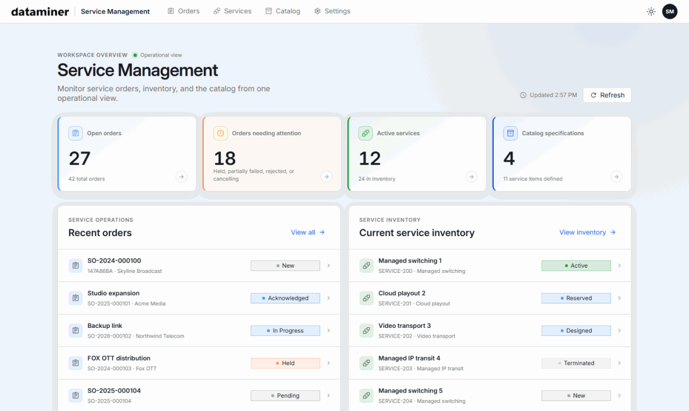

# Service Management

## About

**Service Management** gives your organization one place to **design, order, and run services end to end**. Instead of tracking service definitions, customer orders, and live services in separate tools and spreadsheets, your teams work from a single web app connected to DataMiner.

The solution follows the service life cycle concepts of the [TM Forum Open APIs](https://www.tmforum.org/oda/open-apis/directory):

- **Design** services once as reusable specifications in the **Catalog**.
- **Order** services and follow each order from request to completion.
- **Inventory** every delivered service, with its configuration, state, and history.

Combined with MediaOps or DataMiner SRM, service items can be automated as jobs or bookings, so ordering a service turns directly into planned, executable work.

## Key Features

### Design reusable service specifications

Define what a service of a given type consists of: its **service items** (MediaOps workflows or SRM bookings), properties, and **configuration parameters**. Every new order and service starts from this blueprint, which keeps delivery consistent and reduces manual errors.

### Track service orders from request to completion

Create service orders and order items, move them through a **stateful life cycle**, and request cancellations with a documented reason. Orders stay linked to the services they create, so you always know where a request stands.

### Manage the live service inventory

See all services at a glance, filter them by state, and drill into each service's items, operations, related orders, and **versioned configurations**. Create, edit, duplicate, or retire services directly from the inventory.

### Organize services with categories and logos

Group services into **categories and types**, and assign logos that are applied consistently throughout the inventory, so operators can recognize services instantly.

### Integrate through an open REST API

Every capability in the app is also available through the **Service Management user-defined API**, so you can connect order-management, OSS/BSS, or customer portals to create and follow services automatically.

## Use Cases

- **Satellite**: Order and deliver uplink and downlink services or VSAT terminal activations from a predefined specification.
- **Media & Broadcast**: Manage events and channels as services, from the initial order to the scheduled resources.
- **Telecommunications**: Keep a single inventory of fixed and mobile network services, with each one linked to the order that created it.
- **IT**: Offer software, hardware, and security services from a standardized catalog.

## Prerequisites

- [Standard Data Model Registration](https://catalog.dataminer.services/details/52173e49-9185-4772-9b60-c186ee365a81) (version 2.x)
- [DOM ImportExport](https://catalog.dataminer.services/details/8ce7d7af-62f6-4cfd-8687-663e24f3c5be) (version 1.0.x)
- *Optional:* [MediaOps](https://catalog.dataminer.services/details/1b67a623-4ca6-4d25-8b3d-ed4e39496a75), only needed to automate service items as MediaOps jobs.
- *Optional:* DataMiner SRM license, only needed to automate service items as SRM bookings.

## Pricing

The applications in this package consume DataMiner credits based on how much you use them. Credits are deducted monthly based on metered usage. For more information, see [Usage-based services](https://aka.dataminer.services/usage-based-pricing).

## Technical Reference

For help with this solution, contact the [DataMiner Support team](https://aka.dataminer.services/contacting-tech-support).